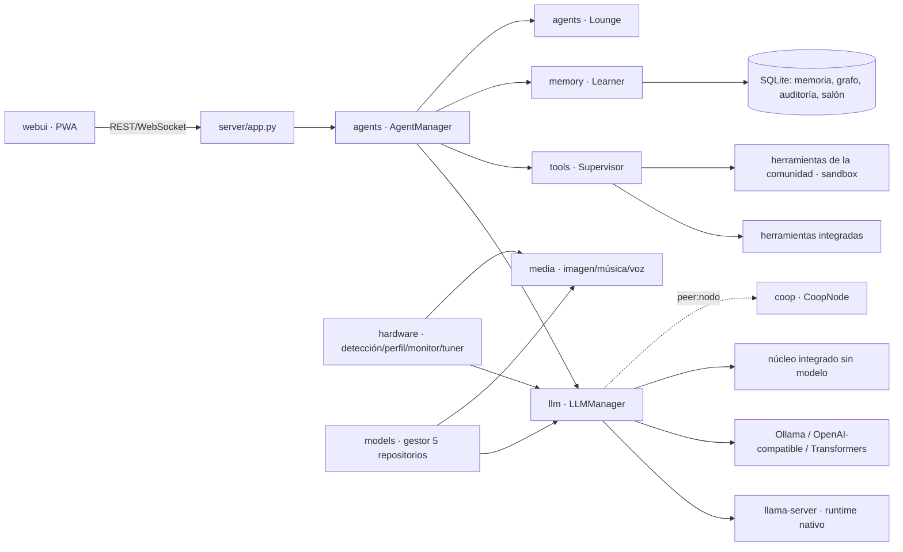

# Arquitectura

## Estructura

| Ruta | Responsabilidad |
|---|---|
| `nexus/paths.py` | Rutas portables relativas al proyecto (`NEXUS_DATA_DIR` para redirigir los datos). |
| `nexus/config.py` | Configuración en dos niveles (`user.*` editable en modo Usuario; el resto solo Admin) y PIN PBKDF2. |
| `nexus/hardware/` | `detect.py` (CPU/RAM/GPU/NPU/runtimes), `android_accel.py` (CPU/GPU/NPU del móvil), `profiles.py` (perfil óptimo), `monitor.py` (muestras, latido, resumen de sesión), `tuner.py` (autoajuste). |
| `nexus/runtimes.py` | Descarga y localiza binarios oficiales de llama.cpp y stable-diffusion.cpp por variante (cpu, cuda, rocm, vulkan, sycl, openvino, metal). |
| `nexus/service.py` | Arranque automático como servicio: systemd, cron `@reboot`, launchd, Programador de tareas de Windows y termux-services (`python -m nexus servicio`, ver [SERVICIO.md](SERVICIO.md)). |
| `nexus/downloads.py` | Instaladores de `<datos>/descargas/` clasificados por plataforma para *Sistema → Descargas*. |
| `nexus/proc.py` | Subprocesos ligados a la vida de Nexus-Office (Job Object en Windows, PDEATHSIG en Linux). |
| `nexus/llm/` | Backends (`llamaserver`, `llamacpp`, `ollama`, `openai`, `transformers`, `builtin`), protocolo de herramientas, recorte de contexto. |
| `nexus/memory/` | Embeddings (sentence-transformers › Ollama › hashing), `MemoryStore`, `KnowledgeGraph`, `Learner`. |
| `nexus/agents/` | `AgentManager` (enrutado, prompt, bucle de herramientas, delegación) y `Lounge` (salón virtual). |
| `nexus/tools/` | Registro modular, supervisor, ejecutor aislado y propuestas con análisis AST. |
| `nexus/models/` | Catálogo, lector GGUF, 5 fuentes, recomendaciones por hardware. |
| `nexus/media/` | Imagen, música y voz con degradación elegante. |
| `nexus/coop/` | Cifrado, invitaciones y nodo de la LAN virtual. |
| `nexus/server/` | API REST + WebSocket. |
| `nexus/remote/` | Acceso remoto: certificado propio y TLS 1.3 (`tlscert`), dispositivos y códigos de emparejamiento (`devices`), UPnP (`upnp`) y `RemoteGate`, la puerta ASGI del puerto HTTPS que exige la llave del dispositivo en HTTP y WebSocket. |
| `nexus/web/` | Interfaz (HTML/CSS/JS sin dependencias de compilación), avatar 3D y salón en canvas, PWA. `js/device.js` detecta el cliente (app Android, PWA o navegador) y el dispositivo antes del primer pintado y marca `<html>` con `data-layout` (phone/tablet/desktop), `data-orient`, `data-input` y `data-lowpower`; el CSS adapta el diseño con esos atributos. |

## Flujo de un mensaje

1. La UI envía `{"type":"chat"}` por WebSocket.
2. `AgentManager.run` elige agente (palabras clave + habilidades aprendidas en el salón), el `Learner` extrae hechos del mensaje y construye el contexto (recuerdos, hechos del grafo, ejemplos valorados, lecciones).
3. **Vía rápida**: intenciones inequívocas (crear imagen/música, calcular, hora) se ejecutan directamente con su herramienta.
4. Si no, el LLM responde en streaming. Con `llama-server`/OpenAI se usan **llamadas nativas a herramientas**; con otros backends, un protocolo de texto `<tool>{…}</tool>` compatible con cualquier modelo.
5. Cada herramienta pasa por el **Supervisor** (validación, política por riesgo, aprobación, límite de tiempo, sandbox, auditoría).
6. La respuesta se guarda, el grafo se actualiza (el avatar lo refleja) y el salón registra la tarea.

## Perfiles de hardware

| Hardware | Acelerador | Ejemplo de decisión |
|---|---|---|
| NVIDIA | `cuda` | Todas las capas en GPU, modelo según VRAM (≥20 GB → 32B), flash attention, Whisper en GPU, MusicGen. |
| AMD dedicada | `vulkan` (Windows) / `rocm` (Linux) | Capas en GPU, PyTorch DirectML para imagen/música en Windows. |
| Intel Arc | `vulkan` / `xpu` / `sycl` | Capas en GPU. |
| Intel/AMD integrada | `cpu` (con `openvino`/`vulkan` como alternativas medibles) | La CPU suele ganar en modelos pequeños. |
| Apple Silicon | `metal` | Memoria unificada, ANE como NPU. |
| Solo CPU | `cpu` | Modelo según RAM y núcleos (2 núcleos → ≤3B), hilos = núcleos físicos. |
| NPU | `openvino` / `onnxruntime-qnn` / Ryzen AI / CoreML | Descarga de embeddings y voz cuando el runtime está disponible. |
| Android (app autónoma) | `hexagon` (NPU de Snapdragon 8 Gen 2+) / `opencl` (Adreno) / `vulkan` (Mali, Immortalis, Xclipse, PowerVR) / `cpu` | `hardware/android_accel.py` detecta SoC, GPU y NPU (con `libllama-server-gpu.so --list-devices`: `HTP0`, `GPUOpenCL`, `Vulkan0`); orden NPU → GPU → CPU, con vuelta automática si una falla al arrancar; el autoajuste compara el acelerador con la CPU con respuestas reales. Las NPU de MediaTek, Tensor y Exynos se informan pero llama.cpp no las usa. |

### Autoajuste en cada arranque
El monitor guarda el resumen de cada sesión (tokens/s, latencia, RAM/VRAM pico, errores) y un latido periódico. Al arrancar, el *tuner*:

- reduce contexto/lote/capas GPU si hubo **falta de memoria** (no si simplemente se cerró la aplicación);
- recupera progresivamente el perfil base tras sesiones estables;
- amplía el contexto si sobra RAM;
- **explora** distintos números de hilos y se queda con el más rápido medido;
- sugiere un modelo más pequeño si la velocidad es baja.

Mínimos de seguridad: contexto ≥ 2048 y lote ≥ 128.
