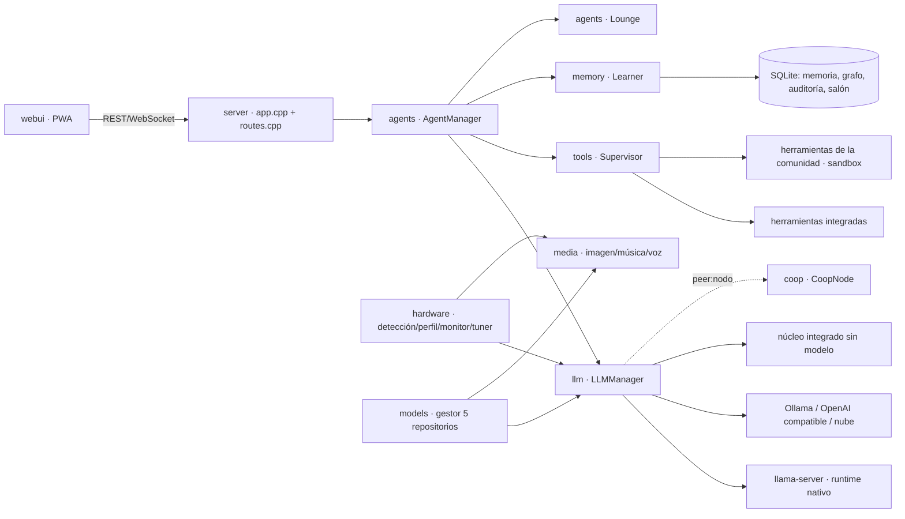
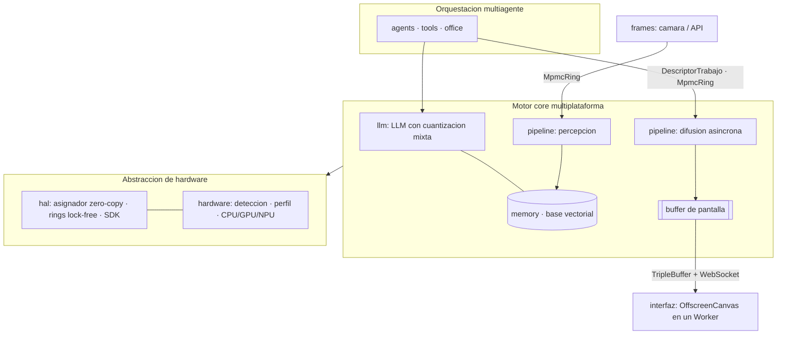

# Arquitectura

## Estructura

Agente IA es un único ejecutable en C++20 (`nexus-office`). Al lado lleva `nexus/` con la interfaz web y los
recursos (perfiles, agentes, paquetes de conocimiento, certificados raíz) y `bundled/runtimes/` con llama-server,
sd-cli, Piper y Whisper. El código está en `nexus-office-cpp/`:

| Ruta | Responsabilidad |
|---|---|
| `src/main.cpp` | Línea de órdenes (`run`, `detect`, `modelos`, `servicio`, `oficina`, `chat`, `grafo`, `bolsa`, `comprobar`, `firmware`...). |
| `src/core/` | Configuración en dos niveles (`user.*` editable en modo Usuario; el resto solo Admin) y PIN PBKDF2 (`config`), base de datos SQLite (`db`), arranque automático como servicio (`service`, ver [SERVICIO.md](SERVICIO.md)), comprobación y autorreparación al arrancar (`salud`) y autoajuste de Android (`android_tune`). |
| `src/hardware/` | `detect` (CPU/RAM/GPU/NPU/runtimes), `android_accel` (CPU/GPU/NPU del móvil), `gpu_devices` (dispositivos que ve llama-server), `profile` (perfil óptimo, selector CPU/GPU/NPU y autoajuste), `hw_profiles` (perfiles por equipo) y `monitor` (muestras, latido, resumen de sesión). |
| `src/models/` | Catálogo recomendado, lector GGUF, 5 fuentes de descarga y `runtimes` (localiza y descarga llama.cpp y stable-diffusion.cpp por variante: cpu, cuda, rocm, vulkan, sycl, openvino, metal). |
| `src/llm/` | Motores (`llamaserver`, `ollama`, `openai`, `nube` para el Profesor y el núcleo integrado `builtin`), protocolo de herramientas y recorte de contexto. |
| `src/memory/` | Embeddings (GGUF en llama-server › Ollama › hashing), memoria, grafo de conocimiento, organizador, importación de grafos en 55 formatos y aprendizaje. |
| `src/agents/` | Gestor de agentes (enrutado, prompt, bucle de herramientas, delegación), actividad y salón virtual. |
| `src/tools/` | Registro modular, supervisor, herramientas integradas y propuestas con análisis estático. |
| `src/rag/` | Lectores de documentos, PDF, archivos comprimidos, extracción y rastreo web, guardar una URL como PDF. |
| `src/media/` | Imagen (stable-diffusion.cpp o el compositor de escenas que dibuja lo que dice el prompt), música procedural, voz (Piper, voz del sistema, Whisper), avatares y GIMP. |
| `src/office/` | Perfiles de oficina, mesa de bolsa y agente de bolsa autónomo. |
| `src/coop/` | Cifrado, invitaciones y nodo de la LAN virtual. |
| `src/remote/` | Acceso remoto: certificado propio y TLS, dispositivos y códigos de emparejamiento, UPnP y VPN WireGuard. |
| `src/devices/` | Luces NexusLED, reloj NexusWatch, Pico W, drivers USB-serie y grabador de firmware nexus-flash. |
| `src/server/` | Servidor HTTP y WebSocket (cpp-httplib) y todas las rutas de la API. |
| `src/util/` | Ficheros, procesos (ligados a la vida de Agente IA: Job Object en Windows, PDEATHSIG en Linux), HTTP, expresiones regulares (PCRE2), YAML, XML, CSV, cifrado, archivos tar/zip. |
| `recursos/web/` | Interfaz (HTML/CSS/JS sin dependencias de compilación), avatar 3D y salón en canvas, PWA. `js/device.js` detecta el cliente (app Android, PWA o navegador) y el dispositivo antes del primer pintado y marca `<html>` con `data-layout` (phone/tablet/desktop), `data-orient`, `data-input` y `data-lowpower`; el CSS adapta el diseño con esos atributos. |
| `tools/construir/` | `nexus-construir`: instaladores, APK, manuales en PDF, prueba de humo y datos (ver [CPP.md](CPP.md#nexus-construir)). |

## Tres capas (dossier de arquitectura, 3.1)

| Capa | Carpetas | Qué hace |
|---|---|---|
| Orquestación multiagente | `agents/`, `tools/`, `office/` | Decide: elige agente, razona con el LLM, llama herramientas. Ante una instrucción multimodal (`generate_image`) envía un `DescriptorTrabajo` a la difusión. |
| Motor core multiplataforma | `llm/`, `memory/`, `rag/`, `media/`, `pipeline/`, `server/` | Ejecuta: motores de LLM (llama.cpp, LiteRT-LM, ONNX GenAI, Genie), embeddings y base vectorial, percepción y difusión. |
| Abstracción de hardware | `hal/`, `hardware/` | Memoria zero-copy, colas lock-free, SDK compilados (`NEXUS_SDK_*`), detección y elección de CPU/GPU/NPU. |

### Memoria zero-copy y colas lock-free (`src/hal/`)
- `zerocopy.h`: `Buffer` (referencia contada a un bloque alineado a 4096 bytes), `Pool` (reciclado con lista libre
  lock-free) y memoria `Compartida` (memfd en Linux/Android, `CreateFileMapping` en Windows) con `descriptor()` para
  que un proceso hijo la mapee. Un dato grande se escribe una vez y después solo viajan referencias: ring → percepción,
  difusión → buffer de pantalla → respuesta HTTP (`Raw::vista`, sin copiar).
- `ring.h`: `SpscRing` (índices en líneas de caché separadas), `MpmcRing` (cola acotada de Vyukov), `TripleBuffer`
  (último frame, el escritor nunca espera) y `Senal` (`std::atomic::wait`/`notify`, un futex). `nexus-tests hal` y
  `GET /api/hal/latencia` miden la ida entre hilos: unos 300 ns en un equipo de 4 hilos.
- Hoy llama-server y sd.cpp son procesos aparte que reciben las peticiones por HTTP; los bloques compartidos ya llevan
  su descriptor para que un motor en proceso (o un hijo que lo mapee) use la misma memoria sin copiarla.

### Pipelines (`src/pipeline/`)
- **Percepción**: `POST /api/pipeline/frame` (cuerpo `image/*` o multipart `frame`) o la cámara del Estudio. Un hilo
  propio decodifica, calcula la huella visual (rejilla 8×8 de color), descarta repetidos, describe con la red de visión
  en el acelerador (llama-server con mmproj, como mucho cada `pipeline.vision_cada_s` segundos) y guarda descripción,
  embedding y huella en la tabla `percepcion`. Búsqueda: `GET /api/pipeline/percepcion?q=` y la herramienta
  `percepcion_buscar`. Si la cola está llena el frame se descarta (429): la cámara nunca espera.
- **Difusión**: `POST /api/pipeline/difusion` o `generate_image`. Un hilo propio ejecuta sd.cpp (sd-server con el
  modelo cargado o sd-cli con `--preview` paso a paso) y publica cada paso en el buffer de pantalla. El presentador
  avisa por WebSocket (`pantalla`, `difusion`, `percepcion`) y `GET /api/pipeline/pantalla` sirve el último frame.
- Configuración: `pipeline.vision_cada_s` (10) y `pipeline.guardar_frames` (true, en `outputs/percepcion/`).

### Compilación cruzada (CMake 3.28)
`CMakePresets.json`: `linux` (ELF autocontenido), `windows`, `windows-dll` (`nexus-office.exe` + `nexus_core.dll`),
`android` (lo que usa la entrega) y `android-so` (`libnexus_core.so` con `c++_shared`), más variantes con SDK
(`linux-vulkan`, `linux-cuda`, `windows-directml`, `android-npu`). Opciones: `NEXUS_CORE_SHARED` y
`NEXUS_SDK_CUDA|VULKAN|OPENCL|QNN|NNAPI|DIRECTML|OPENVINO` (definen `NEXUS_SDK_<X>` y enlazan el SDK). Por defecto no
se compila ningún SDK dentro: los motores se cargan en tiempo de ejecución y el mismo binario sirve en cualquier equipo.

## Motores del dossier (3.2)

| Pieza | Dónde | Qué hace |
|---|---|---|
| Difusión ONNX | `src/media/difusion_onnx.*` | ONNX Runtime cargado con `dlopen` (API C): tokenizador CLIP, codificador de texto, UNet con Euler y VAE dentro del proceso; tensores en bloques del asignador y salida de la UNet preasignada. También el codificador de visión CLIP/SigLIP de la percepción. |
| Memoria del acelerador | `src/hal/zerocopy.*` | `Memoria::DmaBuf` (rpcmem o `/dev/dma_heap`), `CudaPinned`, `HipRegistrada`, `Compartida` y `Host`, elegida por el perfil (`memoria_para`). |
| Núcleos grandes | `src/hal/cpu.*` | Detecta núcleos de rendimiento y fija a ellos los hilos de cálculo. |
| Matriz por chip | `src/hal/matriz.*` | Orden de motores y proveedores para LLM, difusión y visión según el chip. |
| Motores en proceso | `src/llm/motores.*` | LiteRT-LM, ONNX GenAI y Genie dentro del proceso; marca de caída y vuelta al proceso aparte. |
| MCP | `src/mcp/` | Servidor (`POST /mcp`, `nexus-office mcp`) y cliente (`mcp.servidores` → herramientas `mcp_*` en el registro). |

## Flujo de un mensaje

1. La UI envía `{"type":"chat"}` por WebSocket.
2. El gestor de agentes elige agente (palabras clave + habilidades aprendidas en el salón), el aprendizaje extrae hechos del mensaje y construye el contexto (recuerdos, hechos del grafo, ejemplos valorados, lecciones).
3. **Vía rápida**: intenciones inequívocas (crear imagen/música, calcular, hora) se ejecutan directamente con su herramienta.
4. Si no, el LLM responde en streaming. Con `llama-server`/OpenAI se usan **llamadas nativas a herramientas**; con otros backends, un protocolo de texto `<tool>{…}</tool>` compatible con cualquier modelo.
5. Cada herramienta pasa por el **Supervisor** (validación, política por riesgo, aprobación, límite de tiempo, sandbox, auditoría).
6. La respuesta se guarda, el grafo se actualiza (el avatar lo refleja) y el salón registra la tarea.

## Perfiles de hardware

| Hardware | Acelerador | Ejemplo de decisión |
|---|---|---|
| NVIDIA | `cuda` | Todas las capas en GPU, modelo según VRAM (≥20 GB → 32B), flash attention, Whisper en GPU. |
| AMD dedicada | `vulkan` (Windows) / `rocm` (Linux) | Capas en GPU. |
| Intel Arc | `vulkan` / `xpu` / `sycl` | Capas en GPU. |
| Intel/AMD integrada | `cpu` (con `openvino`/`vulkan` como alternativas medibles) | La CPU suele ganar en modelos pequeños. |
| Apple Silicon | `metal` | Memoria unificada, ANE como NPU. |
| Solo CPU | `cpu` | Modelo según RAM y núcleos (2 núcleos → ≤3B), hilos = núcleos físicos. |
| NPU | `openvino` / `onnxruntime-qnn` / Ryzen AI / CoreML | Descarga de embeddings y voz cuando el runtime está disponible. |
| Android (app autónoma) | `hexagon` (NPU de Snapdragon 8 Gen 2+) / `opencl` (Adreno) / `vulkan` (Mali, Immortalis, Xclipse, PowerVR) / `cpu` | `src/hardware/android_accel.cpp` detecta SoC, GPU y NPU (con `libllama-server-gpu.so --list-devices`: `HTP0`, `GPUOpenCL`, `Vulkan0`); orden NPU → GPU → CPU, con vuelta automática si una falla al arrancar; el autoajuste compara el acelerador con la CPU con respuestas reales. Las NPU de MediaTek, Tensor y Exynos se informan pero llama.cpp no las usa. |

### Autoajuste en cada arranque
El monitor guarda el resumen de cada sesión (tokens/s, latencia, RAM/VRAM pico, errores) y un latido periódico. Al arrancar, el *tuner*:

- reduce contexto/lote/capas GPU si hubo **falta de memoria** (no si simplemente se cerró la aplicación);
- recupera progresivamente el perfil base tras sesiones estables;
- amplía el contexto si sobra RAM;
- **explora** distintos números de hilos y se queda con el más rápido medido;
- sugiere un modelo más pequeño si la velocidad es baja.

Mínimos de seguridad: contexto ≥ 2048 y lote ≥ 128.
