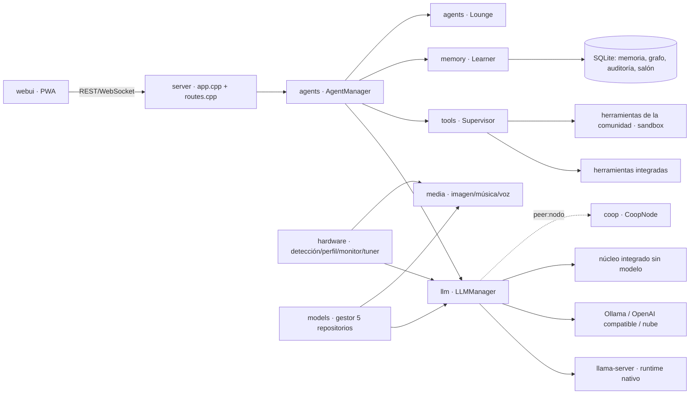

# Arquitectura

## Estructura

Nexus-Office es un único ejecutable en C++20 (`nexus-office`). Al lado lleva `nexus/` con la interfaz web y los
recursos (perfiles, agentes, paquetes de conocimiento, certificados raíz) y `bundled/runtimes/` con llama-server,
sd-cli, Piper y Whisper. El código está en `nexus-office-cpp/`:

| Ruta | Responsabilidad |
|---|---|
| `src/main.cpp` | Línea de órdenes (`run`, `detect`, `modelos`, `servicio`, `oficina`, `chat`, `grafo`, `bolsa`, `comprobar`, `firmware`...). |
| `src/core/` | Configuración en dos niveles (`user.*` editable en modo Usuario; el resto solo Admin) y PIN PBKDF2 (`config`), base de datos SQLite (`db`), arranque automático como servicio (`service`, ver [SERVICIO.md](SERVICIO.md)), comprobación y autorreparación al arrancar (`salud`) y autoajuste de Android (`android_tune`). |
| `src/hardware/` | `detect` (CPU/RAM/GPU/NPU/runtimes), `android_accel` (CPU/GPU/NPU del móvil), `gpu_devices` (dispositivos que ve llama-server), `profile` (perfil óptimo, selector CPU/GPU/NPU y autoajuste), `hw_profiles` (perfiles por equipo) y `monitor` (muestras, latido, resumen de sesión). |
| `src/models/` | Catálogo recomendado, lector GGUF, 5 fuentes de descarga y `runtimes` (localiza y descarga llama.cpp y stable-diffusion.cpp por variante: cpu, cuda, rocm, vulkan, sycl, openvino, metal). |
| `src/llm/` | Motores (`llamaserver`, `ollama`, `openai`, `nube` para el Profesor y el núcleo integrado `builtin`), protocolo de herramientas y recorte de contexto. |
| `src/memory/` | Embeddings (GGUF en llama-server › Ollama › hashing), memoria, grafo de conocimiento, organizador, importación de grafos en 55 formatos y aprendizaje. |
| `src/agents/` | Gestor de agentes (enrutado, prompt, bucle de herramientas, delegación), actividad y salón virtual. |
| `src/tools/` | Registro modular, supervisor, herramientas integradas y propuestas con análisis estático. |
| `src/rag/` | Lectores de documentos, PDF, archivos comprimidos, extracción y rastreo web, guardar una URL como PDF. |
| `src/media/` | Imagen (stable-diffusion.cpp o arte procedural), música procedural, voz (Piper, voz del sistema, Whisper), avatares y GIMP. |
| `src/office/` | Perfiles de oficina, mesa de bolsa y agente de bolsa autónomo. |
| `src/coop/` | Cifrado, invitaciones y nodo de la LAN virtual. |
| `src/remote/` | Acceso remoto: certificado propio y TLS, dispositivos y códigos de emparejamiento, UPnP y VPN WireGuard. |
| `src/devices/` | Luces NexusLED, reloj NexusWatch, Pico W, drivers USB-serie y grabador de firmware nexus-flash. |
| `src/server/` | Servidor HTTP y WebSocket (cpp-httplib) y todas las rutas de la API. |
| `src/util/` | Ficheros, procesos (ligados a la vida de Nexus-Office: Job Object en Windows, PDEATHSIG en Linux), HTTP, expresiones regulares (PCRE2), YAML, XML, CSV, cifrado, archivos tar/zip. |
| `recursos/web/` | Interfaz (HTML/CSS/JS sin dependencias de compilación), avatar 3D y salón en canvas, PWA. `js/device.js` detecta el cliente (app Android, PWA o navegador) y el dispositivo antes del primer pintado y marca `<html>` con `data-layout` (phone/tablet/desktop), `data-orient`, `data-input` y `data-lowpower`; el CSS adapta el diseño con esos atributos. |
| `tools/construir/` | `nexus-construir`: instaladores, APK, manuales en PDF, prueba de humo y datos (ver [CPP.md](CPP.md#nexus-construir)). |

## Flujo de un mensaje

1. La UI envía `{"type":"chat"}` por WebSocket.
2. El gestor de agentes elige agente (palabras clave + habilidades aprendidas en el salón), el aprendizaje extrae hechos del mensaje y construye el contexto (recuerdos, hechos del grafo, ejemplos valorados, lecciones).
3. **Vía rápida**: intenciones inequívocas (crear imagen/música, calcular, hora) se ejecutan directamente con su herramienta.
4. Si no, el LLM responde en streaming. Con `llama-server`/OpenAI se usan **llamadas nativas a herramientas**; con otros backends, un protocolo de texto `<tool>{…}</tool>` compatible con cualquier modelo.
5. Cada herramienta pasa por el **Supervisor** (validación, política por riesgo, aprobación, límite de tiempo, sandbox, auditoría).
6. La respuesta se guarda, el grafo se actualiza (el avatar lo refleja) y el salón registra la tarea.

## Perfiles de hardware

| Hardware | Acelerador | Ejemplo de decisión |
|---|---|---|
| NVIDIA | `cuda` | Todas las capas en GPU, modelo según VRAM (≥20 GB → 32B), flash attention, Whisper en GPU. |
| AMD dedicada | `vulkan` (Windows) / `rocm` (Linux) | Capas en GPU. |
| Intel Arc | `vulkan` / `xpu` / `sycl` | Capas en GPU. |
| Intel/AMD integrada | `cpu` (con `openvino`/`vulkan` como alternativas medibles) | La CPU suele ganar en modelos pequeños. |
| Apple Silicon | `metal` | Memoria unificada, ANE como NPU. |
| Solo CPU | `cpu` | Modelo según RAM y núcleos (2 núcleos → ≤3B), hilos = núcleos físicos. |
| NPU | `openvino` / `onnxruntime-qnn` / Ryzen AI / CoreML | Descarga de embeddings y voz cuando el runtime está disponible. |
| Android (app autónoma) | `hexagon` (NPU de Snapdragon 8 Gen 2+) / `opencl` (Adreno) / `vulkan` (Mali, Immortalis, Xclipse, PowerVR) / `cpu` | `src/hardware/android_accel.cpp` detecta SoC, GPU y NPU (con `libllama-server-gpu.so --list-devices`: `HTP0`, `GPUOpenCL`, `Vulkan0`); orden NPU → GPU → CPU, con vuelta automática si una falla al arrancar; el autoajuste compara el acelerador con la CPU con respuestas reales. Las NPU de MediaTek, Tensor y Exynos se informan pero llama.cpp no las usa. |

### Autoajuste en cada arranque
El monitor guarda el resumen de cada sesión (tokens/s, latencia, RAM/VRAM pico, errores) y un latido periódico. Al arrancar, el *tuner*:

- reduce contexto/lote/capas GPU si hubo **falta de memoria** (no si simplemente se cerró la aplicación);
- recupera progresivamente el perfil base tras sesiones estables;
- amplía el contexto si sobra RAM;
- **explora** distintos números de hilos y se queda con el más rápido medido;
- sugiere un modelo más pequeño si la velocidad es baja.

Mínimos de seguridad: contexto ≥ 2048 y lote ≥ 128.
